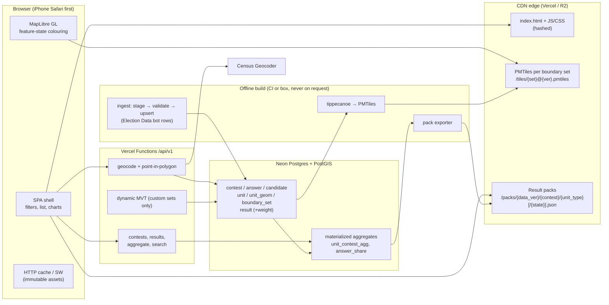

# US Districts v3: architecture (Phase 1 plan)

> Status: **plan only**. The user has a Neon account (no project yet; a `dev` branch comes first, and its connection string reaches v3 only as a secret once builds are approved; see HOSTING_COST.md). Branch `v3/plan`, based on `main` at `509d31d` (build 1567). Nothing has been deployed and no accounts have been created. v2 (`v2/`, live at https://ge0r9b.github.io/us-districts/v2/) stays untouched and remains the reference until v3 reaches parity. Per REPO-RULES.md rule 5, v3 does not deploy or merge to main until v2.0 is tagged and the user approves.

## 1. What v3 must do (from the repo docs)
- Keep everything v2 does (MIGRATION_CHECKLIST.md): institution and geo filters, map/list/chart views, time slider with delta, % / # mode, sort, back stack, ≈ estimates, gray where data is missing, light mode, Liquid Glass round buttons, and an iOS-Safari-first layout.
- Replace the 5.9 MB single file plus about 190 MB of JS-wrapped data (HANDOFF §2, §5) with a database, an API, static tiles and result packs. Spec §12: "Serve geometry as tiles. Do not ship 59 MB of precinct JS."
- Generalize to any contest and any year (2016 is in v2 as a 3-point slider 2016 / 2020 / 2024, decided Oct 18, 2026; the v3 time slider takes N years): offices beyond President, ballot measures, multi-choice, and any number of answers. **Intake: `data-v3/` (bot rows, TIGER GEOIDs) is primary, and `v2/data` is the legacy fallback** (DATA_LOADING.md §0, §8, §9).
- Leave room for paid custom boundary sets, live votes (spec §10) and non-geographic institutions.
- **Instant response time is the top priority** (REPO-RULES rule 7). Every choice below is ranked by that first.

## 2. Stack (recommended; alternatives in DECISIONS.md)
| Layer | Choice | Why |
|---|---|---|
| Front end | **TypeScript + Vite SPA** (Preact or React; components per spec §12: InstitutionFilter, GeoFilter, TopicField, LayersButton, TimeRow, FormatToggle, MapView, ListView, ChartView, CandidateThumbs) | The app is one interactive screen; server rendering adds little. A static shell on the CDN gives the fastest TTFB and no cold starts. Next.js is the alternative if SEO pages per place are wanted (D1). |
| Map | **MapLibre GL JS** (BSD-3) with vector tiles | WebGL; it recolours through `feature-state` without re-creating geometry. v2 had to hand-build this (build 1564: "map year change recolours existing polygons"). |
| Geometry delivery | **Pre-built PMTiles** (one archive per boundary set, built with tippecanoe) on a static CDN | Immutable, cached forever, no database in the map path. Dynamic `ST_AsMVT` from PostGIS is only a fallback (custom or private sets). |
| Results delivery | **Static result packs** (compact JSON, gzip/brotli) per contest × unit type (× state for precincts), at versioned immutable URLs; the same shapes come from the API for anything not pre-built | Past elections are static (spec §4.2, §10.2), so a pack fetch is a CDN hit. |
| API | **Vercel Functions** (Node, Fluid compute) with a small router (Hono), in the region nearest Neon (us-east) | Thin, read-only. Used for geocode, point-in-polygon, search, aggregates not pre-built, and custom sets. |
| Database | **Neon Postgres 16 + PostGIS + pg_trgm** | Serverless Postgres with branching (one branch per preview), scale-to-zero, PostGIS included on every plan (neon.com/pricing, read Oct 18, 2026). Supabase was the spec's earlier pick and is still an option (D2). |
| Basemap | Keep Esri World Street Map for parity at first; evaluate a self-hosted Protomaps/OSM basemap PMTiles before commercial use | Esri commercial terms are unverified (spec §9.3). |
| Geocoder | Census Geocoder, server-side, cached; then PostGIS point-in-polygon | Free, public domain, US only. See GEOCODER.md. |
| Tests | Playwright (as v2's `tests/`), plus API contract tests and SQL fixture tests | v2 tests encode the UI rules; port them. |

## 3. Diagram


## 4. Geometry and data strategy
1. **Geometry and values are separate.** Tiles carry only `id` (= `unit.id`), `key` and `name`, plus a small `parent` id for precincts. Colours come from result packs joined client-side via `map.setFeatureState({source, id}, {v: ...})`. Changing year, answer, %/# or delta never refetches tiles. It recolours the existing features in one frame.
2. **One PMTiles archive per boundary set and version**, for example `precincts-2024@3.pmtiles` or `sldl-2024@1.pmtiles`. Zoom ranges: states z0–z12; counties z3–z12; districts z4–z12; precincts z8–z14. Low zooms use tippecanoe's own simplification; feature ids stay stable across zooms. Tiles are capped at about 200 KB gzip each. v2's display switching (statewide shading when the lower 48 fits, counties when zoomed, precincts when one county fills ≥ 35 % of the view; spec §6) becomes layer `minzoom`/`maxzoom` plus a view-coverage check in the client.
3. **Result packs** (static, immutable):
   `/packs/{data_version}/{contest_key}/{unit_type}.json`, or per state for precincts: `/packs/{data_version}/{contest_key}/precinct/{ST}.json`.
   Shape: `{"v":3,"answers":["dem_nominee","rep_nominee","other"],"ids":[...],"votes":[[d,r,o],...],"total":[...],"est":"<bitset base64>"}`. That is about 20 KB gzip for all 3,143 counties. Packs for a year pair (2020 + 2024) let delta mode compute locally.
   Packs are **per year** (one per contest), mirroring v2's lazy per-year files (`election2016.js`, `ds2016-*.js`, `precincts2016/` are loaded only when 2016 is shown). Adding a year adds files and never grows existing ones.
4. **Postgres is the source of truth and the dynamic path.** Packs and tiles are rebuilt from it after each data load (`data_version` increments), never on request.
5. **Custom or paid boundary sets** (later): served from `/api/v1/tiles/{set}/{z}/{x}/{y}.mvt` (PostGIS `ST_AsMVT` over `unit_geom` lod 1–3) with tenant auth, until they are popular enough to pre-build.

## 5. Caching
| Asset | URL pattern | Cache-Control |
|---|---|---|
| JS/CSS (hashed) | `/assets/app.[hash].js` | `public, max-age=31536000, immutable` |
| HTML shell | `/` | `public, max-age=0, s-maxage=60, stale-while-revalidate=86400` (new builds reach users within about a minute; replaces v2's BUILD polling, build 1560) |
| PMTiles | `/tiles/{set}@{ver}.pmtiles` (HTTP Range) | `public, max-age=31536000, immutable` |
| Result packs | `/packs/{data_version}/...` | `public, max-age=31536000, immutable` |
| `GET /api/v1/manifest` (current versions) | — | `public, max-age=60, s-maxage=60, stale-while-revalidate=600` |
| API reads (pinned `?dv=`) | `/api/v1/...?dv=42` | `public, max-age=86400, s-maxage=31536000, immutable` |
| API reads (unpinned) | `/api/v1/...` | `public, s-maxage=300, stale-while-revalidate=86400` |
| Geocode | `/api/v1/geocode?q=` | `private, max-age=3600`; server cache by address hash (GEOCODER.md) |

The client fetches the manifest once at load. Every later URL embeds its versions, so almost every request is a CDN hit and invalidation is just a new version number.

## 6. Restore strategy: milestone git tags
Releases and tags are owned by the orchestrator (REPO-RULES lanes table: "Grok Bot … releases/tags"). The v3 lane **proposes** tags in its reports and never creates or moves them itself.

**Convention** (annotated tags, `git tag -a <name> -m "<summary>" <sha>`; never moved or deleted once pushed):
| Tag | Meaning | Example |
|---|---|---|
| `v2.0` | Frozen v2 reference (prerequisite for any v3 deploy, rule 5) | the `main` commit the user approves |
| `v2.0.N` | v2 hotfixes after the freeze | `v2.0.1` |
| `v3.0-plan` | This approved Phase 1 plan | tip of `v3/plan` after review |
| `v3.0-alpha.N` | First running v3 builds (preview only) | `v3.0-alpha.1` |
| `v3.0-beta.N` | Feature parity reached (MIGRATION_CHECKLIST all checked) | `v3.0-beta.1` |
| `v3.0-rc.N` | Release candidates on production infrastructure | `v3.0-rc.1` |
| `v3.0` | v3 live | — |
| `data-YYYYMMDD[-N]` | A data snapshot loaded into Postgres (DB `data_version` recorded in the tag message) | `data-20261018` |

**Restore paths**
- **Code:** redeploy any tag (Vercel lets you redeploy a past deployment or Git ref; GitHub Pages v2 can be restored by checking out `v2.0` into `v2/` in a normal new commit, never a force push).
- **Database:** every `data-*` tag records the `data_version` and the Neon branch or snapshot name. Restore = point the API at that Neon branch, or re-run the idempotent ingest from the tagged data files (DATA_LOADING.md §7).
- **Tiles and packs:** URLs are versioned and immutable. Rolling back is a manifest change to the old versions (files are kept at least 90 days).

## 7. Security and privacy
- The API connects with a read-only Postgres role; ingest uses a separate writer role, run offline only.
- No raw addresses are stored or logged (only a SHA-256 for the cache).
- Tenant data (custom sets) is filtered by tenant in the API, with Row Level Security on `unit`/`boundary_set` once tenants exist.
- Licenses: `license.commercial_ok` blocks NYT C-UDA-derived rows from any paid product until they are replaced (spec §9.3, §12.6). The NYT credit stays while any NYT-derived row remains.
- Scraped institution lists: public pages only, robots.txt and terms of service honoured, license recorded per source row (DATA_LOADING §15.3).

## 8. Repo layout (proposed; v3 lane only)
```
docs/v3/        this plan
v3/README.md    scaffold note (no app yet)
v3/app/         SPA (Phase 2)
v3/api/         Vercel functions (Phase 2)
v3/db/          migrations (SCHEMA.sql split into numbered files) + SQL tests
v3/ingest/      staging loader, validators, pack + tile builders
```
Data files stay in the data lanes (`data-v3/results/`, `data-v3/geo/`, per REPO-RULES). v3 reads them and never writes them.

## 8b. Working process
Since Oct 18, 2026 the v3 lane asks the data bots (Election Data, Geo & Institution Data, Institutions, and from now on Companies 7e7bba2a and Governments a901cced) directly and copies the orchestrator. The answers are recorded in DATA_LOADING §10 with dates. The geo merge build removes the last two `../data/` loads from v2.

## 9. Beyond v3 (deliberately left room for, not built in v3.0)
| Later capability | What already makes room for it |
|---|---|
| **Live and weighted voting** (spec §10.3: one vote per user per topic, aggregated by the voter's precinct or institution) | `contest.kind = 'poll'`, `contest.is_static = false` (no static pack, served live); `result.weight` + `weighted_votes` already support weighted tallies; geocoder + `/locate` resolve a voter to units; `POST /votes` reserved in API.md |
| **Auth and accounts** | read-only API role today; `tenant` table; writes isolated from the public read path; RLS planned on tenant-owned rows (§7) |
| **Paid custom boundary sets** | `boundary_set.owner_tenant_id`, `visibility` (public/shared/private), `boundary_set_grant`, `license_id`, `price_tier`; `unit_crosswalk` re-tabulates results into any new set; dynamic MVT path for private sets. Needs the commercial licence work first (NYT-derived data replaced, Vercel Pro) |
| **More years** (2016 is v2's last vote data set; the 3-point slider 2016 / 2020 / 2024 is decided) | every year is a `contest` row with shared `answer_key`s; `boundary_set_default (unit_type, results_year)`; API takes any number of `contest` params |
| **More offices and contest types** (US House, legislatures, school boards, ballot measures, multi-choice, primaries) | `office`, `contest.stage/kind/vote_for`, N answers per contest, `candidate_key` stable across offices; the bot row format already carries `office` and `district` |
| **Institution lists**: public-facing brands, establishments and organizations from Wikidata (`wikidata:Q<id>`, store locations) from the Companies bot (7e7bba2a), and governments flagged sovereign or incorporated from the Governments bot (a901cced) | `entity.kind` `brand` / `company` / `nonprofit` / `fund` / `government_other`, `entity_relation` (brand → parent QID, dates), `entity_location` (`hq_in` / `establishment_at`, Point + GIST), `entity_merge` + `entity_alias` (former QIDs, `usd:` re-keys), `entity_history` + `retraction`. Pipeline in DATA_LOADING §15 |
| **User add/upload with moderation** | `app_user`, `submission` (pending/approved/rejected, evidence URL), `moderation_log`, `rate_limit_bucket`; API `/submissions` (phase 3+). Needs auth (D18) |
| Other countries (Canada parked) | `entity.kind` `nation`; per-country config for district types |

### Roadmap: when each piece lands
| Phase / version | Lands | Depends on |
|---|---|---|
| **Phase 1 (now)** | This plan: schema, API and loaders, on paper | — |
| **Phase 2 → v3.0-alpha** | Neon `dev` branch; SCHEMA migrations; loaders for results (`data-v3/results`), geography (`data-v3/geo`), the entity registry (`data-v3/inst/entities.csv` + xwalk), persons and officeholders; static packs + PMTiles; SPA at v2 parity on open data; QA by the Bug Tester on a preview URL or a branch served on ports 8850–8859 | D1–D4, D17 accounts |
| **v3.0** | Public launch at parity; milestone tag | v2.0 tag; QA sign-off |
| **v3.1** | List ingest: **Wikidata brands + locations** (Companies bot) **plus governments** (Governments bot), deduped and merged with the registry | Companies + Governments bots' files; scraped-data policy (DATA_LOADING §15.3) |
| **v3.2** | Scheduled refresh: Vercel Cron (or a worker) runs the scrapers, diffs applied with history (`valid_from`/`valid_to`, retract list, no silent deletes) | Writer role off the read path; Vercel Pro if cron frequency or duration exceeds Hobby |
| **v3.3 (phase 3+)** | Auth; user add form + CSV upload; moderation queue, audit log, rate limits; `/submissions` API | D18 auth provider |
| **v4+** | Live and weighted voting; paid custom boundary sets; more years and offices; other countries | Auth; commercial licensing; Vercel Pro |
| **v5 / v6** | **Bridge to the user's private corporate database** (LEI/CIK crosswalk via `entity_alias` reserved schemes). It stays **off the public v3 surface**: no public API fields, no static packs, server-side only | User's server + auth; a separate private connection |

## 10. Phase 2 plan (summary)
1. Merge-only from main; create the Neon project + `dev` branch when the user approves builds (D17).
2. `v3/db`: SCHEMA.sql split into migrations; SQL fixture tests.
3. `v3/ingest`: results loader (by header name; `boundary_set` col 14, `method` 15), geography loader, entity registry + xwalk loader, persons/officeholders loader, validations R01–R14, packs and tiles.
4. `v3/app` + `v3/api`: parity features (MIGRATION_CHECKLIST), Playwright port.
5. **QA:** the Bug Tester QAs v3 as soon as there is a Vercel preview URL or a servable branch on **ports 8850–8859** (local static server), at phone and iPad sizes. Findings go to `BUGS.md` on `qa/bugs`, and v3 fixes are tracked against those IDs. (The v3 lane's own Playwright runs keep using ports 8860–8899.)
6. Parity gate: MIGRATION_CHECKLIST all green, QA open Criticals = 0, then the orchestrator tags `v3.0-alpha`.
